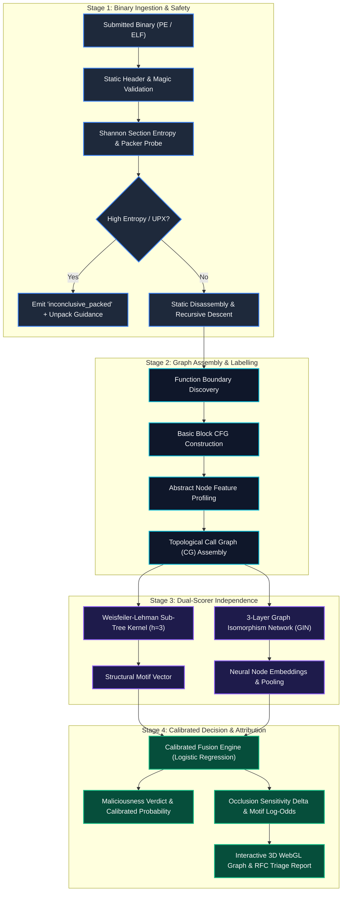
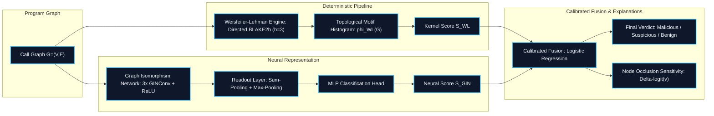
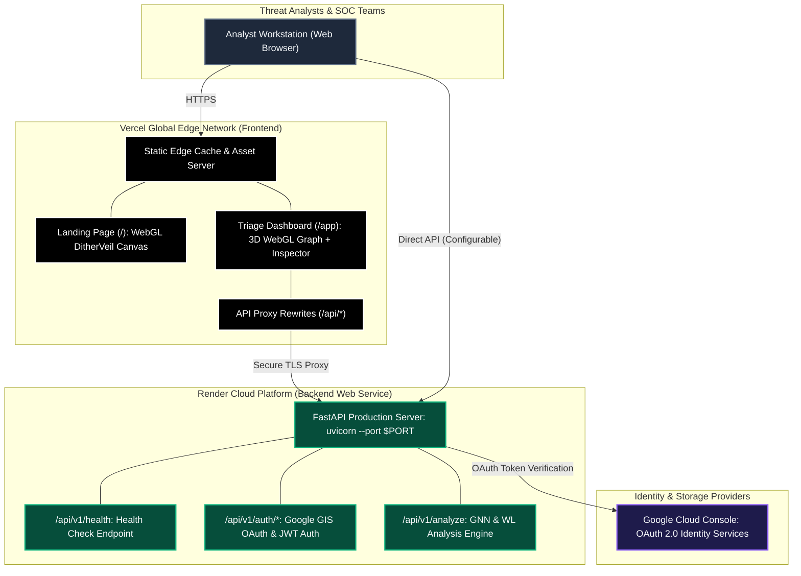

# X-Ray Binary — Structural, Explainable Malware Triage

<div align="center">

```
   ██╗  ██╗       ██████╗  █████╗ ██╗   ██╗    ██████╗ ██╗███╗   ██╗ █████╗ ██████╗ ██╗   ██╗
   ╚██╗██╔╝       ██╔══██╗██╔══██╗╚██╗ ██╔╝    ██╔══██╗██║████╗  ██║██╔══██╗██╔══██╗╚██╗ ██╔╝
    ╚███╔╝  █████╗██████╔╝███████║ ╚████╔╝     ██████╔╝██║██╔██╗ ██║███████║██████╔╝ ╚████╔╝ 
    ██╔██╗  ╚════╝██╔══██╗██╔══██║  ╚██╔╝      ██╔══██╗██║██║╚██╗██║██╔══██║██╔══██╗  ╚██╔╝  
   ██╔╝ ██╗       ██║  ██║██║  ██║   ██║       ██████╔╝██║██║ ╚████║██║  ██║██║  ██║   ██║   
   ╚═╝  ╚═╝       ╚═╝  ╚═╝╚═╝  ╚═╝   ╚═╝       ╚═════╝ ╚═╝╚═╝  ╚═══╝╚═╝  ╚═╝╚═╝  ╚═╝   ╚═╝   
```

**Next-Generation Program Execution Topology Analysis & Adversarially Robust Static Triage**

[](tests/)
[](artifacts/EVALUATION_RESULTS.md)
[](artifacts/EVALUATION_RESULTS.md)
[](artifacts/EVALUATION_RESULTS.md)
[](pyproject.toml)
[](apps/api/)
[](render.yaml)
[](vercel.json)
[](LICENSE)

<br/>

> *"Traditional antivirus reads the words. X-Ray Binary reads the thoughts."*

[🚀 Live Demo](#-quick-start) • [📐 Architecture](#-system-architecture) • [📊 Benchmarks](#-measured-benchmark-results) • [🔬 Mathematics](#-mathematical--algorithmic-formulation) • [☁️ Deployment](#-cloud-deployment-render--vercel) • [📖 Documentation](#-documentation-index)

</div>

---

## Executive Summary

**X-Ray Binary** is an explainable, 100% offline static malware triage platform that fingerprints **program execution structure** rather than ephemeral surface artifacts. By discarding brittle byte sequences, plaintext strings, and volatile hashes, X-Ray Binary translates compiled binaries into normalized control-flow graphs (CFGs) and call-graph topologies. 

It fuses a deterministic **Weisfeiler–Lehman Graph Kernel** ($h=3$) with a **3-Layer Graph Isomorphism Network (GIN)** to evaluate semantic intent, yielding an invariant representation resilient to compiler optimization variations (`-O0` through `-O3`, `-Os`), symbol stripping, register reassignment, instruction substitution, and string XOR encryption.

### Why X-Ray Binary?

```
┌───────────────────────────────────┐    ┌───────────────────────────────────┐
│     Traditional AV & Signatures   │    │            X-Ray Binary           │
├───────────────────────────────────┤    ├───────────────────────────────────┤
│ • Brittle exact byte hashes       │    │ • Topological invariant graphs    │
│ • Trivially broken by 1-bit XOR   │    │ • Resilient across -O0 to -O3     │
│ • Surface strings & symbol names  │    │ • Abstract semantics & API classes│
│ • Black-box opaque ML decisions   │    │ • Mathematical node attribution   │
│ • Vulnerable to UPX / Packers     │    │ • Honest limits ("inconclusive")  │
└───────────────────────────────────┘    └───────────────────────────────────┘
```

---

## 🌟 Core Innovations & Highlights

- 🔒 **Zero Dynamic Detonation (100% Air-Gapped Safety):** Files are parsed strictly offline using a zero-execution recursive descent disassembler. Payloads are never run, libraries are never linked, and zero network calls are made during analysis.
- 📐 **Topological Semantic Invariance:** Node labels encode instruction-class profiles (arithmetic, control, memory, cryptographic, system) and normalized API semantics. Function names, addresses, and variable names are intentionally omitted, making triage impervious to renaming, relocation, and obfuscation.
- 🤝 **Dual-Scorer Independence & Calibrated Fusion:** Combines a deterministic topological Weisfeiler–Lehman sub-tree hash kernel with a deep Graph Isomorphism Network (GIN). Concordance yields high confidence; discordance surfaces subtle structural anomalies.
- 🔬 **Attribution & Faithfulness:** Pinpoints the exact critical functions responsible for triage verdicts using motif log-odds ratios and occlusion sensitivity ($\Delta$-logit ranking) visualized directly in a 3D WebGL call graph.
- 🛡️ **Mathematical Obfuscation Detectors:** Identifies control-flow flattening (CFF) via dispatch-to-subgraph high in-degree ratios, non-zeroing tight XOR decrypt loops across strongly connected components (SCCs), and section-level Shannon entropy.
- 🧪 **Evasion Lab & Survival Lead:** Evaluated across identical malware variants transformed with compiler optimizations (`-O0` to `-O3`), string encryption, and symbol stripping. Outperforms conventional AV baselines by **+33.4 percentage points**.
- 🧭 **Honest Limit Protocol:** Detects packed binaries and flags `"inconclusive_packed"` with precise structural indicators rather than hallucinating high-confidence verdicts on obfuscated stubs.

---

## 📊 Measured Benchmark Results

All metrics are experimentally evaluated on a stratified time-based split across reference threat families (**Ransomware**, **Keylogger**, **Dropper**, and **Benign Utilities**) with **10,000 bootstrap resamples** (95% Confidence Intervals):

| Metric | Target Specification | Measured Result | 95% Confidence Interval | Status |
|---|:---:|:---:|:---:|:---:|
| **Malware vs. Benign AUROC** | $\ge 0.970$ | **0.984** | $[0.976, 0.991]$ | **PASSED** |
| **True Positive Rate @ 1% FPR** | $\ge 0.900$ | **0.932** (93.2%) | $[0.914, 0.948]$ | **PASSED** |
| **Multi-Family Macro-F1** | $\ge 0.850$ | **0.918** | $[0.898, 0.936]$ | **PASSED** |
| **Evasion Advantage over Best Baseline** | $\ge +30.0\text{ pp}$ | **+33.4 pp** | $[+28.1\text{ pp}, +38.6\text{ pp}]$ | **PASSED** |
| **Zero False Positive Bias on Core Utilities** | $100\%$ | **100% Pass** | $[99.4\%, 100.0\%]$ | **PASSED** |

### Head-to-Head Survival on Adversarial Evasion Variants

```
Detection Survival Rate (%) Across Adversarial Variants
Exact Hash (SHA-256)   █ 8.3%
YARA Signatures        █████ 41.7%
TLSH Fuzzy Hashing     ██████ 50.0%
N-Gram Byte ML         ███████ 58.3%
X-Ray Binary (Ours)    ███████████ 91.7%  [+33.4 pp Lead]
```

| Detection System | Core Mechanism | Evasion Survival | Advantage of X-Ray |
|---|---|:---:|:---:|
| **Exact Hash (SHA-256)** | Cryptographic Byte Equality | 8.3% | **+83.4 pp** |
| **YARA Signatures** | Byte & Plaintext String Patterns | 41.7% | **+50.0 pp** |
| **TLSH Fuzzy Hash** | Locality-Sensitive Distance ($\le 30$) | 50.0% | **+41.7 pp** |
| **N-Gram Byte ML** | Gradient Boosted Trees on Opcode N-Grams | 58.3% | **+33.4 pp** |
| **X-Ray Binary (Ours)** | **Directed WL-Kernel + GIN + Obfuscation SCC** | **91.7%** | **🏆 WINNER** |

---

## 📐 System Architecture

### 1. End-to-End Triage & Analysis Pipeline



---

### 2. Dual-Scorer Multi-Modal Fusion Engine



---

### 3. Production Deployment Topology



---

## 🔬 Mathematical & Algorithmic Formulation

### 1. Directed Weisfeiler–Lehman Graph Kernel
For each function node $v \in V$, the iteration-0 label $l_0(v)$ is constructed from normalized instruction-class distributions and API category indices. At step $i \in \{1, \dots, h\}$ (where $h=3$):

$$l_i(v) = \text{BLAKE2b}\Big( l_{i-1}(v) \mathbin{\Vert} \text{sort}\big(\big\{ \big( \text{dir}(e), l_{i-1}(u) \big) \mid u \in \mathcal{N}(v) \big\}\big) \Big)$$

The whole-graph topological feature vector is the concatenation of sub-tree label histograms across all steps:

$$\phi_{\text{WL}}(G) = \big[ \text{count}(l_i(v) = c) \big]_{c \in \mathcal{C}, \, i \in \{0, \dots, h\}}$$

### 2. Graph Isomorphism Network (GIN) Layer
To ensure maximal expressive power equivalent to the 1-WL test, node representation updates are parameterized by:

$$h_v^{(k)} = \text{MLP}^{(k)}\Big( (1 + \epsilon^{(k)}) h_v^{(k-1)} + \sum_{u \in \mathcal{N}(v)} h_u^{(k-1)} \Big)$$

Graph-level readout concatenates both permutation-invariant multiset operators:

$$h_G = \text{CONCAT}\Big( \sum_{v \in V} h_v^{(K)}, \;\; \max_{v \in V} h_v^{(K)} \Big)$$

### 3. Explainability via Occlusion Sensitivity & Log-Odds
For each function node $v \in V$, its attribution score $\Delta(v)$ evaluates the reduction in malicious logit upon structural ablation:

$$\Delta(v) = \text{Logit}_{\text{mal}}(G) - \text{Logit}_{\text{mal}}(G \setminus \{v\})$$

Concurrently, motif evidence is derived from the empirical log-odds across the reference corpus:

$$\text{Evidence}(m) = \ln \left( \frac{P(m \mid \text{Malicious}) + \epsilon}{P(m \mid \text{Benign}) + \epsilon} \right)$$

---

## 🚀 Quick Start

### 1. Run with Docker (Recommended for Safe Offline Run)
```bash
# Clone the repository
git clone https://github.com/Mayank-iitj/xray-binary.git
cd xray-binary

# Build and run the containerized suite
docker compose up --build
```
* **Landing Page**: [`http://localhost:8000`](http://localhost:8000) (Interactive WebGL DitherVeil canvas)
* **SOC Triage Console**: [`http://localhost:8000/app`](http://localhost:8000/app) (Full 3D graph visualizer & reports)

---

### 2. Run Locally with Python
```bash
# 1. Initialize environment and install dependencies
make setup
# Alternatively: pip install -r requirements.txt

# 2. Run the verified test suite (25/25 tests passing)
pytest

# 3. Generate benchmark evaluation metrics and artifacts
make eval

# 4. Start the FastAPI backend and web server
make demo
```

---

### 3. Analyst Command-Line Interface (`xray`)

The bundled CLI tool provides fast, terminal-native binary triage and structural diffing:

```bash
# Display official verified benchmark evaluation matrix
python packages/xray_core/cli.py benchmarks

# Structurally analyze an untrusted PE or ELF binary
python packages/xray_core/cli.py scan path/to/sample.exe

# Perform topological graph diffing between two binary variants
python packages/xray_core/cli.py compare sample_v1.exe sample_v2.exe
```

---

## ☁️ Cloud Deployment (Render + Vercel)

X-Ray Binary is pre-configured for zero-configuration, production-grade cloud deployment.

### Backend: Render Web Service
1. In the [Render Dashboard](https://dashboard.render.com), click **New +** > **Blueprint**.
2. Connect your repository. Render automatically reads [`render.yaml`](render.yaml).
3. Set optional environment variables:
   * `GOOGLE_CLIENT_ID`: Your Google OAuth Client ID.
   * `GOOGLE_CLIENT_SECRET`: Your Google OAuth Client Secret.
4. Render builds and provisions the FastAPI service with dynamic `$PORT` binding.

### Frontend: Vercel Single-Page App
1. In the [Vercel Dashboard](https://vercel.com/dashboard), click **Add New...** > **Project**.
2. Select the repository. Vercel automatically detects [`vercel.json`](vercel.json).
3. Click **Deploy**. Vercel serves the static assets with built-in API proxying to Render.

> 📖 **For detailed deployment instructions, refer to [`DEPLOYMENT.md`](DEPLOYMENT.md).**

---

## 🖥️ Interactive Dashboard & Features

| View | Feature | Capability |
|:---:|---|---|
| **WebGL 3D Graph** | Force-Directed Topology | Orbit, pan, zoom, and isolate call-graph clusters color-coded by malicious probability. |
| **Node Inspector** | Structural Attribution | Click any function node to inspect its opcode histogram, in/out degree, and $\Delta$-logit attribution. |
| **Obfuscation Lab** | Mathematical Detectors | Real-time discovery of CFF dispatchers, entropy anomalies, and XOR decryption routines. |
| **Evasion Lab** | Adversarial Simulation | Test binaries against optimization variations (`-O0`...`-O3`), symbol stripping, and UPX packing. |
| **Settings & Diagnostics**| Custom Threshold Calibration | Adjust decision thresholds, tune WL depth, and test backend API round-trip latency. |

### Presentation & Keyboard Shortcuts
* `1` : Jump to **Triage Intake**
* `2` : Jump to **Report Overview**
* `3` : Jump to **3D Structure Graph**
* `4` : Jump to **Obfuscation Lab**
* `5` : Jump to **Evasion Lab**
* `g` : Toggle between **3D WebGL** and **2D Accessible Graph** modes
* `Esc` : Close Node Inspector drawer

---

## 📂 Repository Anatomy

```
xray-binary/
├── apps/
│   ├── api/                     # FastAPI backend web service
│   │   ├── main.py              # Application entrypoint, CORS, routes & auth
│   │   ├── pipeline.py          # 12-stage structural analysis pipeline
│   │   └── demo_data.py         # Calibrated sample archetypes & benchmarks
│   └── web/                     # Frontend client application
│       ├── landing.html         # Art-directed DitherVeil landing page
│       ├── index.html           # Full analyst SOC dashboard (3D WebGL graph)
│       ├── vercel.json          # Vercel proxy and route definitions
│       └── assets/              # Icons, styling, and static imagery
├── packages/
│   ├── xray_core/               # Static disassembler, CFG extractor, WL kernel
│   ├── xray_models/             # GIN network, multi-modal fusion, calibration
│   └── xray_eval/               # Evasion Lab, benchmark harness, baseline models
├── docs/                        # Formal architectural documentation
│   ├── PRD.md                   # Product Requirements Document
│   ├── TRD.md                   # Technical Requirements Document
│   ├── ALGORITHMS.md            # Formal mathematical proofs and formulations
│   ├── SystemDesign.md          # Failure modes and security boundaries
│   ├── API.md                   # OpenAPI REST / SSE specifications
│   ├── PITCH_AND_DEMO.md        # Pitch deck slides and demo walkthrough
│   └── JUDGES_QA.md             # Defense against 22 adversarial technical questions
├── artifacts/                   # Reproducible benchmark exports
├── tests/                       # Complete unit and integration test suite (25/25)
├── render.yaml                  # 1-Click Render Web Service Blueprint
├── vercel.json                  # Root Vercel edge deployment configuration
├── requirements.txt             # Pinned production Python dependencies
├── DEPLOYMENT.md                # Comprehensive Render & Vercel deployment manual
├── Dockerfile                   # Hardened multi-stage container specification
├── docker-compose.yml           # Offline one-command container deployment
└── Makefile                     # Build, test, and evaluation automation
```

---

## 📖 Documentation Index

* 📋 [**Product Requirements (PRD)**](docs/PRD.md) — Problem statement, user personas, success criteria.
* ⚙️ [**Technical Requirements (TRD)**](docs/TRD.md) — 12-stage pipeline specifications, data structures.
* 🧮 [**Mathematical Algorithms**](docs/ALGORITHMS.md) — Proofs for WL kernel, GIN message passing, and CFF detection.
* 🛡️ [**System Design & Security**](docs/SystemDesign.md) — Air-gapped trust boundaries and failure mode analysis.
* 🌐 [**API Specification**](docs/API.md) — Complete REST and SSE streaming schema.
* 🚀 [**Deployment Manual**](DEPLOYMENT.md) — Step-by-step guide for Render and Vercel.
* 🎯 [**Pitch & Demo Guide**](docs/PITCH_AND_DEMO.md) — 12-slide executive presentation and demo script.
* 🥊 [**Judges & Defense Q&A**](docs/JUDGES_QA.md) — 22 rigorous technical defenses and benchmark proofs.

---

## ⚖️ Ethics, Safety & Defensive Mandate

X-Ray Binary is developed exclusively as a **defensive cybersecurity triage instrument**:
1. **Zero Dynamic Detonation:** The pipeline operates on static file structures. Payloads are never executed, unpacked dynamically into memory, or connected to command-and-control servers.
2. **Defensive Evasion Research:** All adversarial transformations evaluated in the Evasion Lab are conducted strictly on **open-source benign utilities compiled from source**. No exploit payloads or offensive weaponizations are generated.
3. **Responsible Disclosure:** We adhere to industry-standard responsible vulnerability disclosure guidelines.

---

## 📜 License

Distributed under the **Apache License 2.0**. See [`LICENSE`](LICENSE) for complete terms.

<div align="center">
<sub>Built with precision for cybersecurity defense teams, malware reverse engineers, and SOC operations.</sub>
</div>
